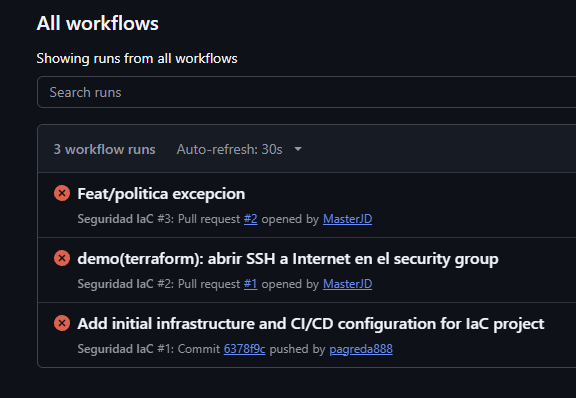
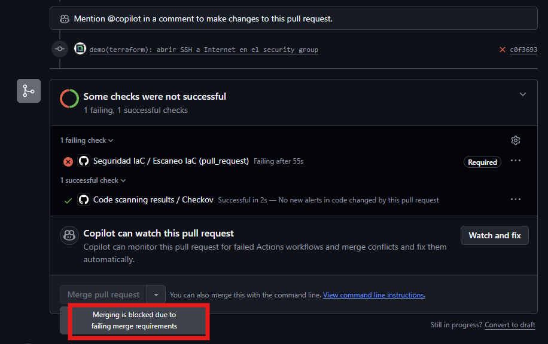
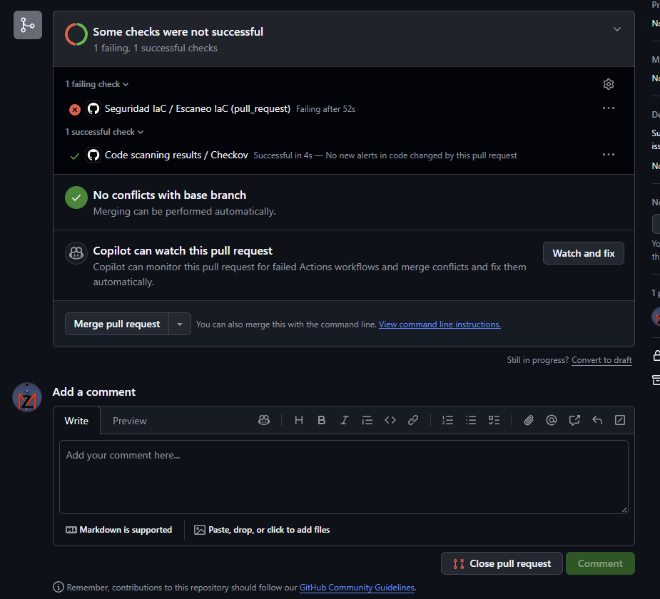
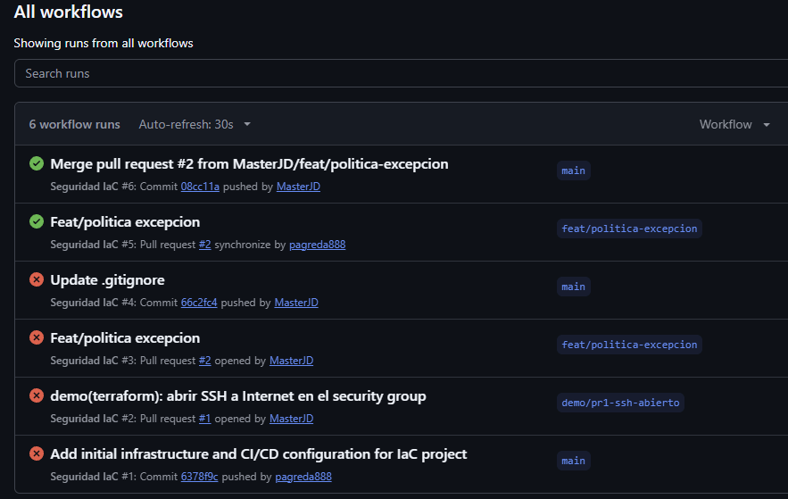
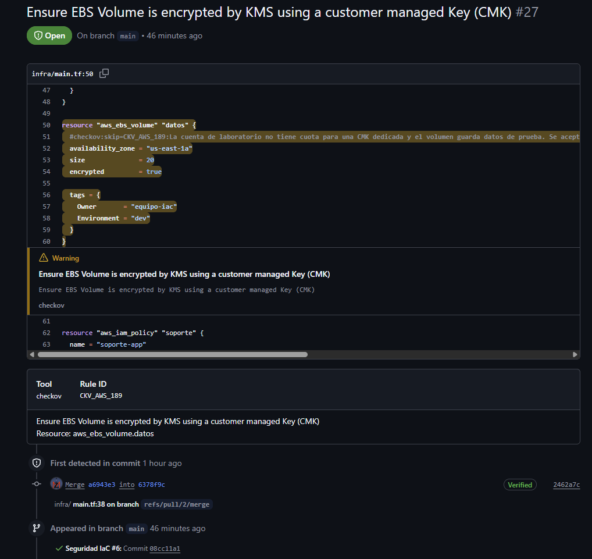
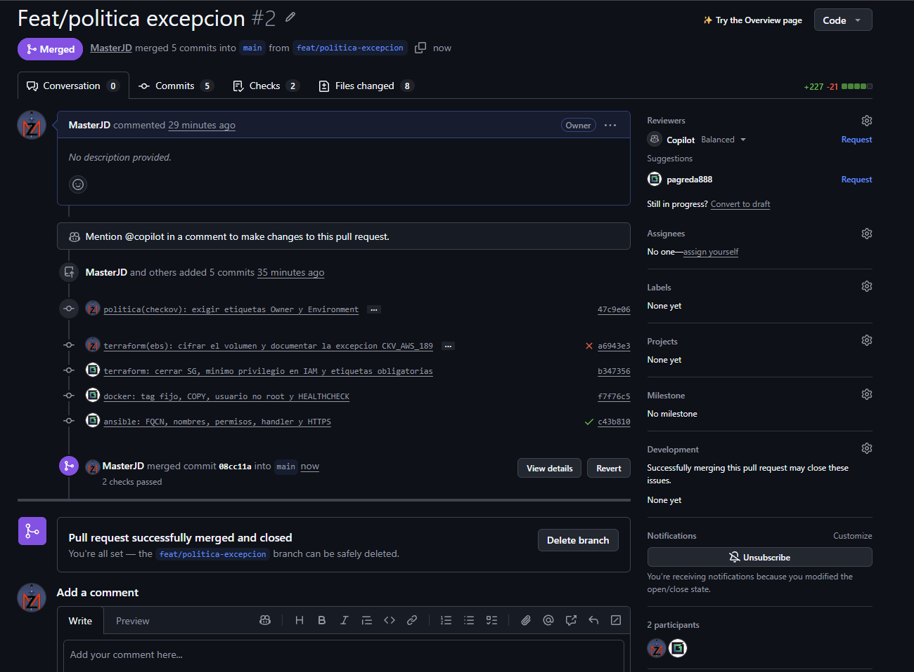

# Análisis de seguridad IaC en el pipeline

Universidad Galileo, Posgrado en Desarrollo de Software Seguro, curso de Ciberseguridad.

| Integrante | Carné |
|---|---|
| Pablo Agreda | 17001969 |
| Javier Donado | 17001625 |

**Informe completo:** [docs/informe.pdf](docs/informe.pdf)

## Descripción

El repositorio integra el análisis de infraestructura como código como un control automático del pipeline, de modo que cada cambio en Terraform, Ansible o el Dockerfile se escanea dentro del pull request y no puede fusionarse en `main` cuando introduce una configuración insegura.

## Estructura

```
.
├── .github/workflows/iac-security.yml   # Job "Escaneo IaC"
├── infra/                               # Terraform
├── ansible/                             # site.yml + inventory.ini
├── docker/                              # Dockerfile
├── politicas/                           # Política propia de Checkov (YAML) y ejemplos
├── evidence/                            # Capturas de evidencia
├── .ansible-lint                        # profile: production
└── docs/informe.pdf                     # Informe del laboratorio
```

## Pipeline

El workflow `Seguridad IaC` se ejecuta en cada `pull_request` y en cada `push` a `main` con versiones fijas (`checkov==3.4.5`, `ansible-core==2.22.0`, `ansible-lint==26.11.0`, Python 3.13). Primero genera el reporte SARIF sin bloquear y lo publica en Code Scanning, y después aplica tres gates que detienen el cambio: Checkov con la política propia, la validación de sintaxis de Ansible y ansible-lint con el perfil production. El ruleset de `main` exige pull request y el check `Escaneo IaC` como obligatorio, sin lista de bypass.

## Pull requests

| PR | Propósito | Resultado |
|---|---|---|
| [#1](https://github.com/MasterJD/Laboratorio-IaC_17001969-17001625/pull/1) | Primer intento del gate, con SSH abierto a Internet | Cerrado sin fusionar; el check aún no era obligatorio |
| [#2](https://github.com/MasterJD/Laboratorio-IaC_17001969-17001625/pull/2) | Política propia, excepción y remediación | Fusionado con el job en verde |
| [#3](https://github.com/MasterJD/Laboratorio-IaC_17001969-17001625/pull/3) | Demostración del gate con SSH a `0.0.0.0/0` | Bloqueado y cerrado sin fusionar |
| [#4](https://github.com/MasterJD/Laboratorio-IaC_17001969-17001625/pull/4) | Referencia a la aprobación de la excepción | Fusionado con el job en verde |

## Resumen de resultados

| Herramienta | Línea base | Después de la remediación |
|---|---|---|
| Checkov, Terraform | 14 fallas | 0 fallas, 1 excepción (CKV_AWS_189) |
| Checkov, Dockerfile | 4 fallas | 0 fallas |
| Checkov, Ansible | 1 falla | 0 fallas |
| ansible-lint, perfil production | 14 fallas | 0 fallas |

La única excepción se encuentra en `infra/main.tf` sobre `aws_ebs_volume.datos`, fue [aprobada por MasterJD](https://github.com/MasterJD/Laboratorio-IaC_17001969-17001625/pull/2#issuecomment-7152883338) y vence el 30 de junio de 2027.

## Evidencias

### Línea base: primeras ejecuciones en rojo



### Gate que bloquea: PR #3 con el merge bloqueado



### Primer intento: PR #1 sin check obligatorio



### Historial de ejecuciones



### Reporte SARIF en Code Scanning



### Remediación: PR #2 fusionado con los checks aprobados


